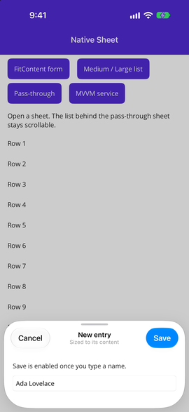
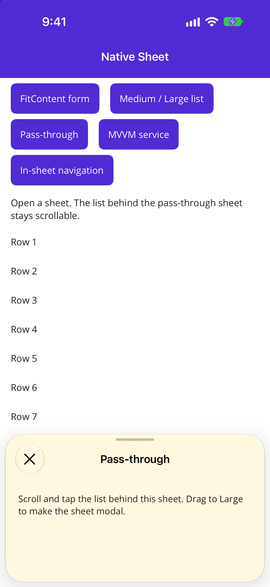
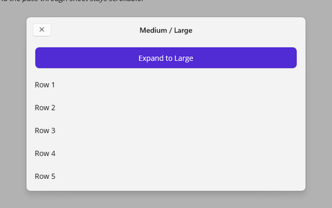
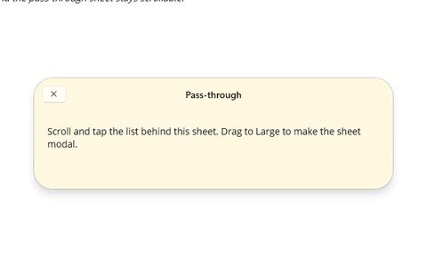

# Plugin.Maui.Sheet

[](https://www.nuget.org/packages/Plugin.Maui.Sheet/)

`Plugin.Maui.Sheet` shows **truly native bottom sheets** in .NET MAUI 11. Both the sheet container and its header are the platform's own controls; no MAUI overlay or MAUI buttons are drawn:

| | iOS / Mac Catalyst | Android | Windows |
|---|---|---|---|
| Container | `UISheetPresentationController` (page sheet in a `UINavigationController`) | Material `BottomSheetDialog` + `BottomSheetBehavior` | Light-dismiss WinUI `Popup`, centred like a Mac sheet |
| Header | `UINavigationBar` with `UIBarButtonItem`s | `MaterialToolbar` with menu actions | WinUI `TextBlock`s and `Button`s (accent primary) |
| Grabber | `PrefersGrabberVisible` | `BottomSheetDragHandleView` | – |

## Screenshots

The [sample app](samples/Plugin.Maui.Sheet.Sample), captured on an Android emulator, an iOS simulator and Windows by the [screenshot workflow](.github/workflows/screenshots.yml). Select a screenshot for the full-size image.

| | FitContent form | Medium / Large list | Pass-through |
|---|---|---|---|
| **Android** | [](https://raw.githubusercontent.com/sebfrie/Plugin.Maui.Sheet/main/screenshots/android-form.png) | [](https://raw.githubusercontent.com/sebfrie/Plugin.Maui.Sheet/main/screenshots/android-list.png) | [](https://raw.githubusercontent.com/sebfrie/Plugin.Maui.Sheet/main/screenshots/android-passthrough.png) |
| **iOS** | [](https://raw.githubusercontent.com/sebfrie/Plugin.Maui.Sheet/main/screenshots/ios-form.png) | [](https://raw.githubusercontent.com/sebfrie/Plugin.Maui.Sheet/main/screenshots/ios-list.png) | [](https://raw.githubusercontent.com/sebfrie/Plugin.Maui.Sheet/main/screenshots/ios-passthrough.png) |

**Windows** (cropped to the sheet, centred in the window)

[](https://raw.githubusercontent.com/sebfrie/Plugin.Maui.Sheet/main/screenshots/windows-form.png)
[](https://raw.githubusercontent.com/sebfrie/Plugin.Maui.Sheet/main/screenshots/windows-list.png)
[](https://raw.githubusercontent.com/sebfrie/Plugin.Maui.Sheet/main/screenshots/windows-passthrough.png)

## Install

```bash
dotnet add package Plugin.Maui.Sheet
```

| Platform | Minimum version |
|---|---|
| iOS | 15 (custom detents need 16, subtitle needs 26) |
| Mac Catalyst | 17 (sheets show as form sheets on Mac) |
| Android | API 24 |
| Windows | 10 version 1809 (10.0.17763) |

These are the oldest OS versions the package runs on. The frameworks NuGet lists (e.g. `net11.0-android37.0`) name the platform SDK the package is compiled against, the .NET 11 default, which any `net11.0-android`/`-ios`/`-windows` app matches; they are not minimums.

## Setup

```csharp
builder
    .UseMauiApp<App>()
    .UseNativeSheet(); // registers the handler and INativeSheetService
```

## Use it in XAML

Put a `NativeSheet` anywhere in the page's layout. It takes no space; its content appears in the native sheet while `IsOpen` is `true`.

```xml
xmlns:sheet="clr-namespace:Plugin.Maui.Sheet;assembly=Plugin.Maui.Sheet"

<sheet:NativeSheet IsOpen="{Binding IsEditing}"
                   Detents="FitContent, Large"
                   Title="New entry"
                   Subtitle="Sized to its content"
                   PrimaryActionText="Save"
                   PrimaryActionCommand="{Binding SaveCommand}"
                   IsPrimaryActionEnabled="{Binding CanSave}"
                   SecondaryActionText="Cancel">
    <VerticalStackLayout Padding="20">
        <Entry Text="{Binding Name}" />
    </VerticalStackLayout>
</sheet:NativeSheet>
```

### Properties

| Property | Default | Description |
|---|---|---|
| `IsOpen` | `false` | Opens/closes the sheet. TwoWay; set to `false` when the user dismisses it. |
| `IsDismissible` | `true` | Allows swipe down / tap outside / back to dismiss. |
| `ShowGrabber` | `true` | Native drag handle (iOS, Android). |
| `IsDraggable` | `true` | Lets the user drag the sheet between detents. Android only; iOS and Windows have no public API for it. |
| `CornerRadius` | `-1` | Top corner radius (all corners on Windows); negative keeps the OS default. |
| `BackgroundColor` | `null` | Sheet background; `null` keeps the OS default. |
| `PassThroughInteraction` | `false` | The page below stays interactive and undimmed at every detent except `Large`. |
| `Detents` | `Medium, Large` | `Medium`, `Large`, `FitContent`, `Fraction:0.3`, `Height:250` (comma separated in XAML, any order). In C#: `SheetDetent.Medium`, `SheetDetent.Fraction(0.3)`, `SheetDetent.Height(250)`, … |
| `SelectedDetent` | `null` | TwoWay. The detent the sheet rests at (`null` = smallest); set it to animate. |
| `Title`, `Subtitle` | | Native header texts. The header hides when it has nothing to show. |
| `PrimaryActionText`, `PrimaryActionCommand`, `PrimaryActionCommandParameter`, `IsPrimaryActionEnabled` | | Trailing confirm action (iOS *Done* style). |
| `SecondaryActionText`, `SecondaryActionCommand`, `SecondaryActionCommandParameter` | | Leading cancel action. |
| `ShowNativeCloseButton` | `false` | Native close (X) button at the leading edge. Always closes the sheet. |
| `Content` | | The MAUI view shown below the header. |
| `ContentTemplate` | | Used when `Content` is `null`: the view is created each time the sheet opens and released when it closes, so closed sheets cost nothing. |

An action without a command simply closes the sheet. With a command, the command decides (set `IsOpen = false` to close).

### Events

| Event | When |
|---|---|
| `Opened` | The sheet finished presenting. |
| `Dismissed` | The sheet closed, by code or by the user. |
| `DetentChanged` | The user moved the sheet to another detent. |
| `DismissAttempted` | The user tried to dismiss. `e.Cancel` starts as `!IsDismissible`; set it to keep the sheet open or clear it to let it close. |

`FitContent` re-measures when the root of `Content` invalidates its measure. After size changes deeper inside the content, call `sheet.InvalidateDetents()`.

## Use it from a view model

```csharp
public class OrdersViewModel(INativeSheetService sheets)
{
    public async Task ShowDetailsAsync()
    {
        // OrderDetailsView is created with constructor injection; the task completes when the sheet closes.
        await sheets.ShowSheetAsync<OrderDetailsView>(sheet =>
        {
            sheet.Title = "Order";
            sheet.Detents = [SheetDetent.FitContent, SheetDetent.Large];
            sheet.ShowNativeCloseButton = true;
        });
    }

    public Task CloseAsync() => sheets.CloseSheetAsync();
}
```

A sheet can return a value: `ShowSheetAsync<TView, TResult>()` completes with what the sheet's view model passes to `CloseSheetAsync(result)`, or `default` when the user dismisses it.

```csharp
// In the calling view model
string? fruit = await sheets.ShowSheetAsync<FruitPickerView, string>(s => s.Detents = [SheetDetent.FitContent]);

// In FruitPickerView's view model
await sheets.CloseSheetAsync("Apple");
```

## Platform notes

- **Android** `BottomSheetBehavior` has three resting states, so at most three distinct detent heights are used (smallest, middle, largest).
- **Android** pass-through: the dialog window is undimmed and touches outside the sheet are re-dispatched to the activity, so lists and maps below scroll and respond to taps. Text input below the sheet does not receive the keyboard while the sheet is open.
- **Android** the drag handle is Material 3; on MAUI's default MaterialComponents theme it is themed with a Material 3 overlay automatically.
- **Android** the sheet is a dialog window, and while it has focus Android takes the status bar icon color from it. The sheet copies the activity's light/dark status bar icon setting, so icons you switched at runtime (e.g. light icons over a dark page) don't flip while a sheet is open.
- **Windows** has no bottom sheet. The sheet is shown like on Mac Catalyst: a card (max 540 wide) centred over the window in a `Popup`, over a dimmed backdrop. Clicking the backdrop or pressing Esc dismisses it (cancelable through `DismissAttempted`); unlike WinUI's built-in light dismiss it stays open when the window is resized or loses focus. Detents only choose its height (`FitContent` sizes to the content); there is no dragging or grabber. With `PassThroughInteraction` (below `Large`) there is no backdrop and the page stays usable.
- **iOS 15** has only medium/large detents; `Fraction`, `Height` and `FitContent` fall back to the nearer one.
- Nested `ScrollView`/`CollectionView` content expands the sheet when scrolled to its edge on both platforms.

## Sample

[`samples/Plugin.Maui.Sheet.Sample`](samples/Plugin.Maui.Sheet.Sample) shows a `FitContent` form with a primary action that enables once text is entered, a `Medium/Large` list with `SelectedDetent` binding, a non-dismissible pass-through sheet over a scrollable list, and a sheet opened from a view model through `INativeSheetService` that returns the user's pick.
